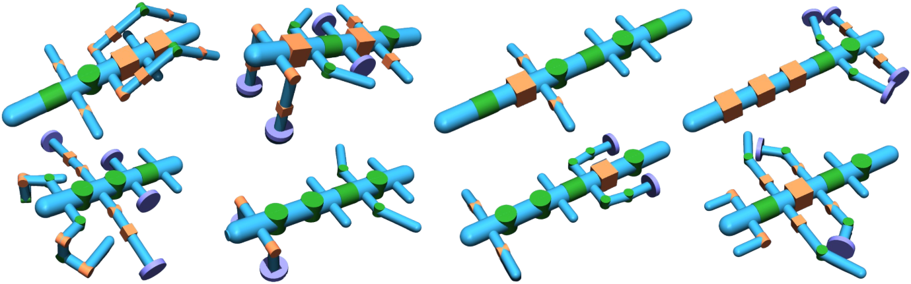
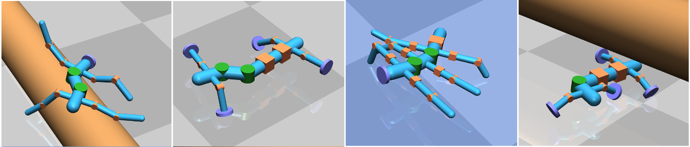

# RoboMorph: Evolving Robot Morphology using Large Language Models

[](https://arxiv.org/abs/2407.08626)
[](LICENSE)
[](https://www.python.org/)
[](https://arxiv.org/abs/2407.08626)

**RoboMorph** automatically discovers diverse, high-performing robot morphologies by combining large language models with evolutionary search. Given a task description, it evolves robot body plans across generations without any manual design.

<p align="center">
  
</p>
<p align="center"><i>Diverse robot morphologies automatically discovered by RoboMorph across different terrains.</i></p>

## How It Works

RoboMorph uses an LLM-guided evolutionary loop to design robots:

1. **Design**: An LLM generates robot designs expressed in a structured grammar.
2. **Compile**: Each design is compiled into a [MuJoCo](https://mujoco.org/) XML model.
3. **Train**: The robot is trained with reinforcement learning (SAC or PPO) using [Brax](https://github.com/google/brax) on GPU-accelerated parallel environments.
4. **Evaluate**: Each robot is scored on its locomotion reward (the final evaluation episode's accumulated forward reward).
5. **Evolve**: The top-performing designs are fed back to the LLM as few-shot examples, guiding the next generation toward better morphologies.

<p align="center">
  
</p>

This loop repeats for many generations, producing increasingly capable robots across four terrain types: ridged, flat, frozen lake, and beams.

<p align="center">
  
</p>
<p align="center"><i>Top-performing robot designs discovered by RoboMorph on each terrain.</i></p>

## Quick Start

### 1. Install

We recommend [uv](https://docs.astral.sh/uv/) for fast, reproducible setup:

```bash
git clone https://github.com/kevinxqiu/robomorph.git
cd robomorph

# Install uv (if you don't have it)
curl -LsSf https://astral.sh/uv/install.sh | sh

# Python 3.10 to 3.12 are supported; 3.11 is a good starting point.
# This installs CPU dependencies for help, compilation and offline checks.
uv sync --locked --python 3.11
uv run --locked robomorph --help
```

<details>
<summary>Alternative: pip</summary>

```bash
python3.11 -m venv .venv
source .venv/bin/activate
python -m pip install -r requirements.txt
robomorph --help
```

</details>

Evolution and standalone RL training use **4096 parallel environments**, so use a Linux machine with an NVIDIA GPU and sufficient GPU memory. CPU installation is useful for the compiler and tests; the evolution CLI checks for a GPU before making LLM requests. Install the matching CUDA support on the GPU machine:

```bash
uv sync --locked --extra cuda12
uv run --locked --extra cuda12 python -c "import jax; print(jax.devices('gpu'))"
```

The extra installs CUDA 12 support for the pinned JAX version. A compatible NVIDIA driver is required; see [JAX installation guidance](https://docs.jax.dev/en/latest/installation.html). Include `--extra cuda12` in subsequent `uv run` commands so uv keeps these dependencies installed. With pip, use `python -m pip install -e '.[cuda12]'` instead. `CUDA_VISIBLE_DEVICES` limits workers to the GPUs assigned to your run. Unset `JAX_CUDA_VISIBLE_DEVICES` and `JAX_PLATFORM_NAME=cpu` for evolution; the worker GPU selection uses the CUDA allocation mask.

### 2. Configure API Keys

```bash
cp .env.example .env
```

Edit `.env` and add your keys:

- **`OPENAI_API_KEY`** (required): Used for LLM-based design generation.
- **`WANDB_API_KEY`** (optional): Enables experiment logging via [Weights & Biases](https://wandb.ai). Leave it empty, or pass `--no_log`, to disable this. `WANDB_ENTITY` and `WANDB_PROJECT` select the logging destination.

### 3. Run

```bash
uv run --locked --extra cuda12 robomorph --exp_name my_experiment --terrain flat
```

This evolves a population of 32 robots over 100 generations on flat terrain using GPT-4o. That is up to 3200 paid LLM requests and 3200 RL training runs, with 1M training timesteps per robot. For an initial pipeline check on a GPU machine, start with a smaller budget:

```bash
uv run --locked --extra cuda12 robomorph --exp_name first_run --terrain flat \
    --population_size 2 --num_generations 1 --timesteps 100000 --no_log
```

Results are saved relative to the working directory. Choose a new experiment name for each run; existing run artifacts are protected from overwriting. This release does not implement resume.

## Usage

```bash
uv run --locked --extra cuda12 robomorph \
    --exp_name <experiment_name> \
    --terrain <flat|ridged|beams|frozen_lake> \
    --population_size 32 \
    --num_generations 50 \
    --model gpt-4o
```

### Arguments

| Argument | Default | Description |
|----------|---------|-------------|
| `--exp_name` | (required) | Experiment name for logging and output files |
| `--terrain` | `flat` | Terrain type: `flat`, `ridged`, `beams`, `frozen_lake` |
| `--population_size` | `32` | Number of robot designs per generation |
| `-n`, `--num_generations` | `100` | Number of evolutionary generations |
| `--model` | `gpt-4o` | OpenAI model used for design generation |
| `--timesteps` | `1000000` | RL training timesteps per robot |
| `--top_k` | `3` | Number of top designs kept as few-shot examples |
| `--seed` | `42` | Python/NumPy and RL training seed; LLM generation is not seeded |
| `--results_path` | `results/results_<exp>.csv` | Output path for the results CSV |
| `-p`, `--problem` | from `robomorph/prompts/user.txt` | Task description text sent to the LLM |
| `--no_log` | off | Disable Weights & Biases logging |

### Outputs and fitness

For `--exp_name first_run`, the default output directory contains:

- `results_first_run.csv`: semicolon-delimited generation results, including the original unit ID, XML path relative to the CSV directory, fitness, diversity and any failure reason.
- `arguments_first_run.json` and `environment_first_run.json`: CLI settings and installed Python/package versions.
- `time_elapse_first_run.csv`: time taken for each generation.
- `examples_first_run/`: the grammar prompt, raw LLM responses (`.txt`) and compiled designs (`.xml`).
- `runs_first_run/`: per-design policy parameters, training configuration and reward plot. Failed training attempts include `failure_<design>.json` with the error and traceback.
- `population_first_run.txt`: the best successful designs used as few-shot context.

`--results_path /path/to/new_directory/results.csv` places the associated artifacts beside that CSV. Training fitness is the final `eval/episode_reward_forward`, an episode sum of negative x velocity in the terrain environment, rather than speed normalized to m/s. Failed or unevaluated designs have `fitness=-inf` and cannot become elites. A generation with no successful evaluations stops with an error. The population training timeout is one hour; it raises an error and stops its workers.

### Experiment settings and reproducibility

The CLI defaults are 32 designs, 100 generations, 1M SAC training timesteps per design and the top 3 successful designs as few-shot context. To run the same configuration across terrains:

```bash
uv run --locked --extra cuda12 robomorph --exp_name flat_run   --terrain flat
uv run --locked --extra cuda12 robomorph --exp_name ridged_run --terrain ridged
uv run --locked --extra cuda12 robomorph --exp_name beams_run  --terrain beams
uv run --locked --extra cuda12 robomorph --exp_name frozen_run --terrain frozen_lake
```

These are runnable release settings, not a guarantee of reproducing the paper's numerical results. The repository does not include the original experiment logs, trained checkpoints or a complete historical hardware/provider environment. `--seed` controls local randomness and RL training, but it does not seed LLM requests; model aliases and API responses can change. Keep the recorded arguments, environment, prompts and responses with your results, and report the model identifier, hardware and repeats for comparisons. Smaller checks above are for pipeline validation, not paper comparisons.

### Training and rendering individual robots

Training a robot XML does not require an OpenAI key. Standalone training defaults to 50M timesteps, while evolution defaults to 1M:

```bash
uv run --locked --extra cuda12 python -m train.train_brax \
    --xml train/control_xmls/ant.xml --terrain flat --algorithm sac \
    --name ant_flat --timesteps 1000000 --no_log
```

The run is saved to `runs/ant_flat_s_42/`. Use a new name or `--output_dir` for a new run. PPO additionally requires a positive `--num_minibatches`, for example `--algorithm ppo --num_minibatches 4`. Run `uv run --locked python -m train.train_brax --help` for the full argument list.

Render a policy you trained locally from the same working directory:

```bash
uv run --locked python -m train.render_policy runs/ant_flat_s_42
```

Rendering uses CPU and writes `trained_render.html`. Only load checkpoints/configuration from sources you trust, as the saved training configuration uses pickle.

### Compiler-only example and offline checks

No GPU or API key is needed to compile a component graph into MuJoCo XML:

```bash
printf '%s\n' '[null]-[body=15cm]-([connector]-[mount]-[knee=30deg]-[limb=10cm]-[null])-[null]' | \
    uv run --locked python -m compiler.compile > robot.xml
uv run --locked python -m unittest discover -s tests -v
```

The tests exercise CLI validation, output protection, result provenance, fitness parsing and worker orchestration using test doubles for LLM/training calls. They also load a compiled XML in MuJoCo without running simulation. CI runs these checks on Python 3.10, 3.11 and 3.12; it does not validate GPU training or paper performance.

## Project Structure

```
robomorph/                     # Main package
    main.py                    # Entry point and CLI
    evolution/                 # Evolutionary algorithm
        __init__.py            # Public API re-exports
        loop.py                # Core evolution loop
        population.py          # EvolutionUnit and Population (Pydantic models)
        utils.py               # Dataset I/O, merging, diversity scoring
        plots.py               # Visualization utilities
    prompts/
        grammar.txt            # Robot grammar specification
        user.txt               # Default task description prompt
compiler/                      # Grammar-to-XML compiler
    compile.py                 # Tokenizer, compiler, and MuJoCo XML generator
    robot_generator.py         # Random robot generation from grammar
train/                         # RL training infrastructure
    train_brax.py              # SAC/PPO trainer (Brax + JAX)
    parallel_train.py          # Multi-GPU parallel training
    render_policy.py           # Policy visualization (HTML)
    envs/                      # Terrain environments (flat, ridged, beams, frozen_lake)
    control_xmls/              # Baseline robot XML (ant)
```

## Citation

If you use RoboMorph in your research, please cite:

```bibtex
@article{qiu2024robomorph,
  title={Robomorph: Evolving robot morphology using large language models},
  author={Qiu, Kevin and Pa{\l}ucki, W{\l}adys{\l}aw and Ciebiera, Krzysztof and Fija{\l}kowski, Pawe{\l} and Cygan, Marek and Kuci{\'n}ski, {\L}ukasz},
  journal={arXiv preprint arXiv:2407.08626},
  year={2024}
}
```

## License

This project is licensed under the MIT License. See [LICENSE](LICENSE) for details.
